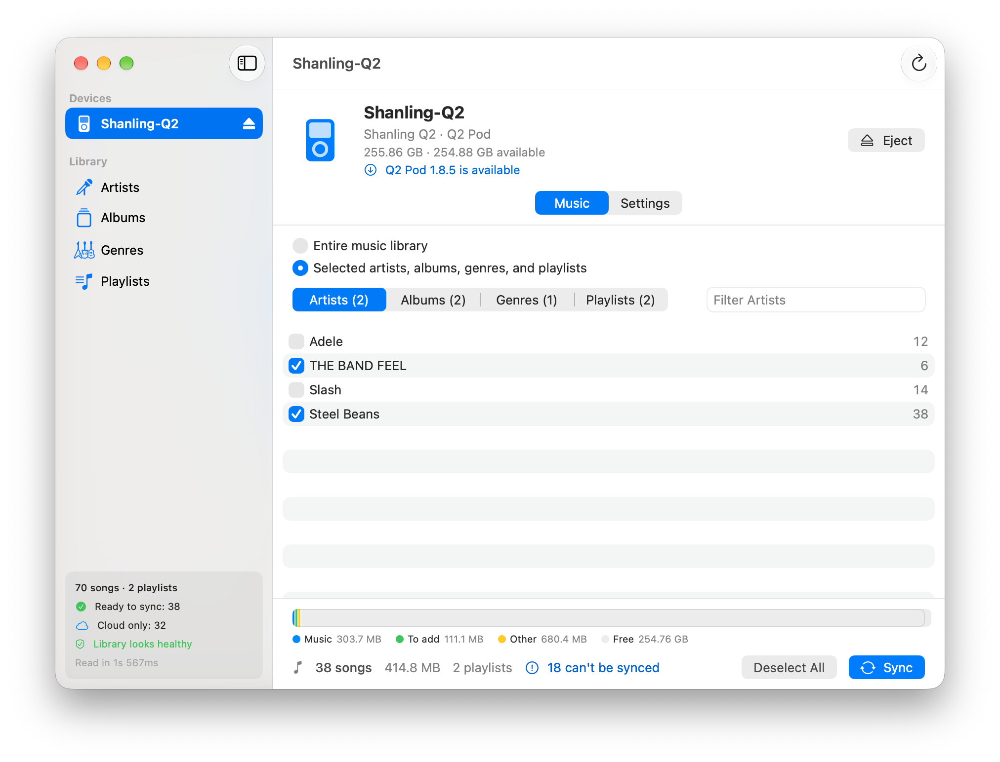
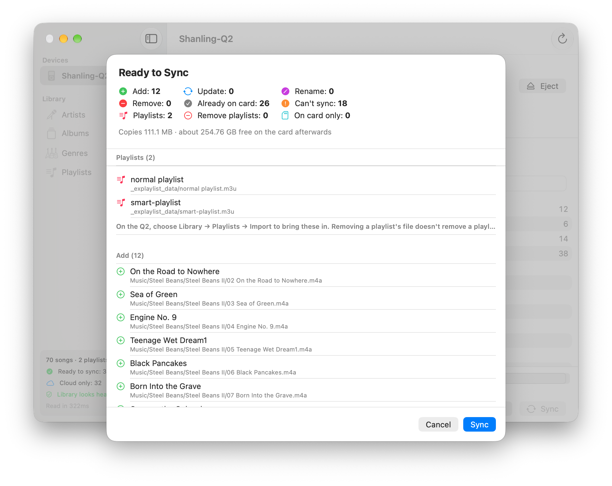
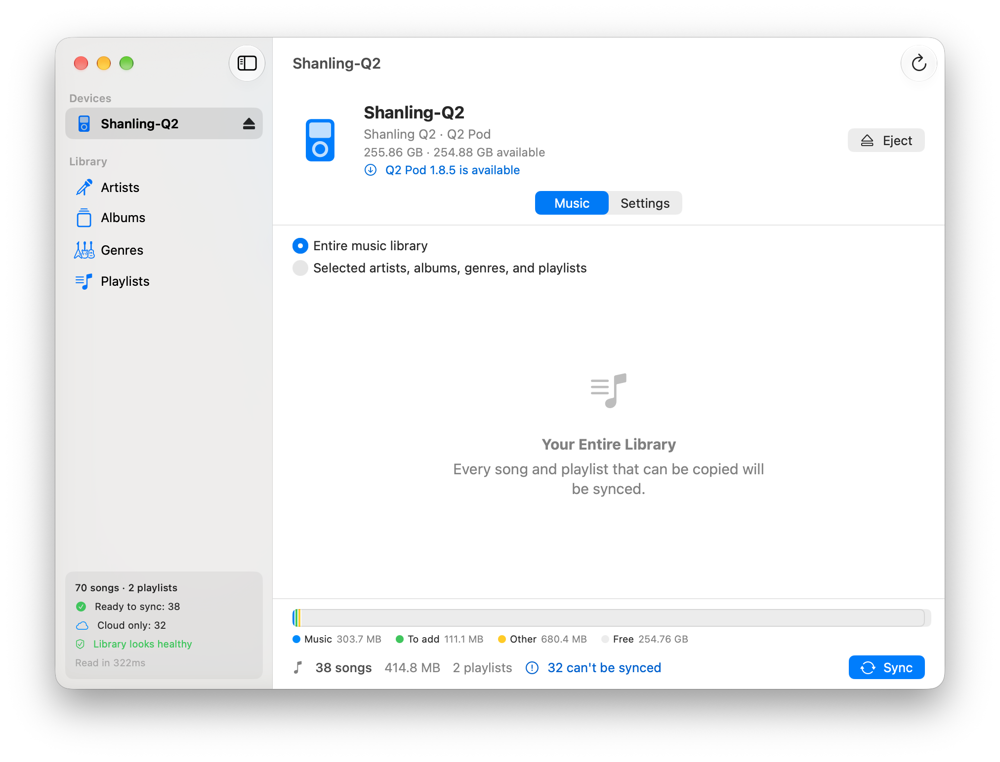
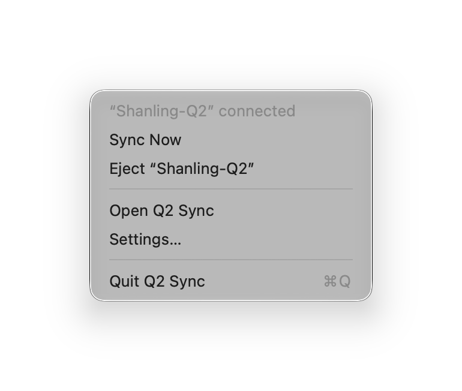

# Q2 Sync

**Sync your Apple Music library to a Shanling Q2, the way Finder syncs an iPod.**

Q2 Sync is a native macOS app for people who keep their music in Apple Music
and listen on a [Shanling Q2](https://en.shanling.com/) portable player,
running either Shanling's stock firmware or the
[Q2 Pod](https://github.com/DiamondBond/q2-pod) custom firmware. The Q2 shows
up on a Mac as a plain drive, with no Finder sync and no playlist sync. Q2 Sync
fills that gap: tick the artists, albums, genres and playlists you want, click
**Sync**, and it copies exactly those to the Q2's microSD card, keeps it up to
date, and writes your playlists in a format the Q2 can import.

> **Safety first:** Q2 Sync is strictly **read-only toward your Apple Music
> library**. It never writes to your library or its media folder in any way.
> It only reads them and copies music *to* the Q2's card.

| | |
| --- | --- |
|  |  |
| *Choose artists, albums, genres and playlists* | *Preview every change before it happens* |
|  |  |
| *Finder-style capacity bar* | *Menu bar item and auto-sync* |

## Features

- **Finder-style selection.** Sync your entire library, or tick artists,
  albums, genres and playlists. New albums by a ticked artist sync
  automatically.
- **Fast, incremental syncs.** Only new or changed songs are copied; retagged
  songs are renamed rather than copied again.
- **Preview before applying.** See every song that will be added, updated,
  renamed or removed. Your first sync with a card is always a preview.
- **Playlists**, including smart playlists, written as `.m3u` files in the Q2's
  `_explaylist_data` folder for **Library → Playlists → Import**.
- **Card-only music.** Music on the card that isn't in your selection is listed
  with a choice for each file: leave it, copy it back to your Mac, move it to
  the card's trash, or delete it. Nothing is removed automatically.
- **Capacity bar** showing music, other files, what a sync adds and free space,
  with a warning when the selection won't fit.
- **Auto-sync** when the Q2 connects (ask first, or sync automatically),
  notifications, a menu bar item, and an option to open at login.
- **Firmware update notices** for Q2 Pod (optional, from GitHub). It never
  downloads or installs firmware.
- **Clean cards:** FAT/exFAT-safe file names, no stray macOS `._` files next to
  synced songs, and firmware folders are never touched.
- **A first-class Mac app:** SwiftUI, sidebar and detail layout, SF Symbols,
  light and dark mode.

## Requirements

- macOS 27.2 or later
- Xcode 27.2 or later (to build)
- A Shanling Q2 with a microSD card formatted **exFAT** or **FAT32**, set to
  **USB Storage** in its quick-access menu (or the card in a card reader)
- Music stored as local files in Apple Music (cloud-only and DRM-protected
  songs are listed but can't be copied)

## Install and build

There's no prebuilt release yet. To build it yourself:

1. Clone this repository.
2. Open `Q2-Sync.xcodeproj` in Xcode.
3. Select the **Q2-Sync** scheme and **My Mac**, then press **⌘R**.

The project signs locally ("Sign to Run Locally"), which is enough to run it
on your own Mac. To share builds, set your Apple Developer team in the target's
**Signing & Capabilities**.

Run the unit tests from the repository root:

```bash
swift test
```

New to the app? Read the [User Guide](docs/USER_GUIDE.md). Want to work on the
code? Start with the [Code Guide](docs/CODE_GUIDE.md).

## Safety

Q2 Sync was designed so that the worst thing that can go wrong is a bad sync to
the card, which you fix by syncing again.

- **Read-only toward Apple Music.** The library is read with Apple's
  `iTunesLibrary` framework, which can't change it. The App Sandbox gives the
  app **read-only** access to `~/Music`, so macOS itself blocks any write
  there. Song files are opened read-only.
- **One path guard.** Every change on the card passes a single checker that
  refuses anything outside the confirmed card, on the wrong or an internal
  disk, inside your Music folder, or on the list of firmware files.
- **The card is recognised by its unique ID**, which you confirm once, so
  another drive is never mistaken for it.
- **"Mac looks empty" guard.** If the library can't be read or your music drive
  is disconnected, the sync stops before touching the card.
- **Nothing is removed without asking.** Removals are off by default, go to a
  trash folder on the card, and removing more than 20% needs extra
  confirmation.
- **Keep a backup.** Backups are best practice regardless: please use Time
  Machine or another backup. Q2 Sync has no backup feature.

## Firmware compatibility

| | Q2 Pod (custom) | Shanling stock |
| --- | --- | --- |
| Syncing music | ✅ | ✅ |
| Playlists (`_explaylist_data/*.m3u`) | ✅ documented format, to verify on device | ✅ same folder, to verify on device |
| "Update the library on your Q2" steps | Library → Update Library → Scan music now | Local Songs → Update Library → Scan music now |
| Firmware update notices | ✅ from GitHub releases | Link to Shanling's download page |
| Card trash hidden from the library | ✅ (`database.ignore`) | May appear; empty it in Finder |

Firmware-specific behaviour lives in one place, `DeviceProfile`, so other
firmware can be added. Some details were documented before a Q2 was available
for testing; see [docs/DEVICE_CHECKS.md](docs/DEVICE_CHECKS.md).

## Credits

- **[Q2 Pod](https://github.com/DiamondBond/q2-pod)** by DiamondBond (GPL-3.0):
  its README, `docs/internals.md`, `docs/discovery.md` and user guide are the
  source of the card layout, playlist folder and format, reserved items and
  library behaviour Q2 Sync relies on. No Q2 Pod code is included.
- **Shanling** for the Q2 Quick Start Guide.
- **[iTunes Export](https://www.ericdaugherty.com/dev/itunesexport/)** by Eric
  Daugherty, used only as a reference for playlist-export edge cases. No code
  is borrowed or bundled (its repository doesn't state a license).

Q2 Sync is an independent project, not affiliated with Shanling, Apple or the
Q2 Pod project.

## License

Q2 Sync is free software, released under the
[GNU General Public License v3.0](LICENSE). You can use, study, share and
improve it; if you distribute changed versions, they must stay open under the
same license. Contributions are welcome.
