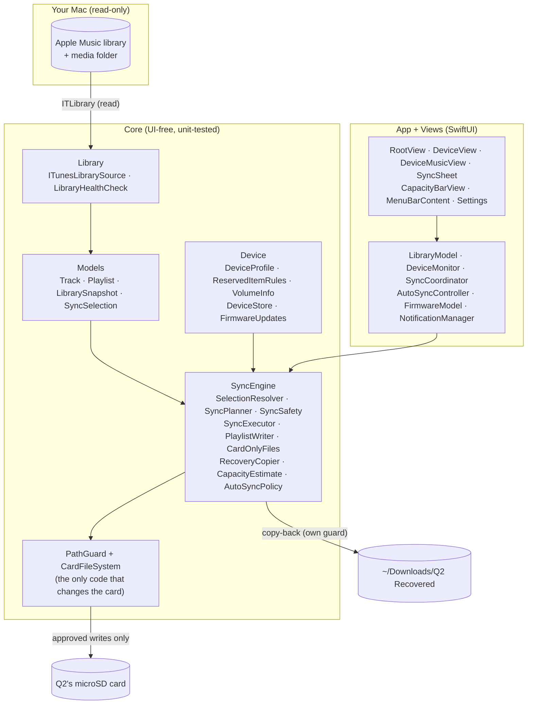
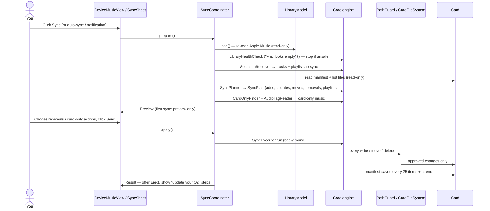

# Q2 Sync — Code Guide and Runbook

This guide explains how Q2 Sync is built: its architecture, how a sync flows,
what every major type does, how device profiles work, the safety design, and
how to build, test and troubleshoot it. It's written for someone new to Swift
and SwiftUI; each source file also starts with a header comment and every type
and function has a `///` doc comment.

> **The rule behind every design decision:** Q2 Sync is strictly **read-only**
> toward your Apple Music library and its media files. The worst acceptable
> failure is a bad sync to the card, which you can fix by syncing again.

---

## Contents

1. [Architecture overview](#1-architecture-overview)
2. [How a sync flows, step by step](#2-how-a-sync-flows-step-by-step)
3. [Major types and functions](#3-major-types-and-functions)
4. [Device profiles (and adding one)](#4-device-profiles-and-adding-one)
5. [Safety design](#5-safety-design)
6. [Build, run and test](#6-build-run-and-test)
7. [Where logs, settings and data live](#7-where-logs-settings-and-data-live)
8. [Troubleshooting](#8-troubleshooting)

---

## 1. Architecture overview

The project has two halves:

- **Core** (`Q2-Sync/Core`) holds all the logic and has **no UI code**. It's
  compiled into the app *and* into a Swift package (`Package.swift`) so it can
  be unit-tested with `swift test`.
- **App + Views** (`Q2-Sync/App`, `Q2-Sync/Views`) hold the SwiftUI interface
  and the glue that connects it to macOS: disk notifications, notifications,
  the menu bar and the login item.



### Folder structure

| Folder | What's in it |
| --- | --- |
| `Q2-Sync/Core/Models` | Plain values: `Track`, `Playlist`, `LibrarySnapshot`, `SyncSelection` |
| `Q2-Sync/Core/Library` | Reading Apple Music: `LibrarySource`, `ITunesLibrarySource`, `FixtureLibrarySource`, `LibraryHealthCheck` |
| `Q2-Sync/Core/Device` | Device facts: `DeviceProfile`, `ReservedItemRules`, `VolumeInfo`, `DeviceStore`, `FirmwareUpdates` |
| `Q2-Sync/Core/SyncEngine` | Planning, diffing, copying, playlists, path guard, safety |
| `Q2-Sync/App` | App entry point and UI-facing models (`@Observable` classes) |
| `Q2-Sync/Views` | SwiftUI views |
| `Tests/Q2SyncCoreTests` | Unit tests (Swift Testing) for Core |
| `Config/Q2Sync.entitlements` | App Sandbox permissions, each one explained |
| `Scripts/` | `install.sh` (build and install in /Applications), app icon generator |
| `docs/` | This guide, the user guide, and the on-device check list |

### Swift features you'll meet

- **`struct` vs `class`:** almost all Core types are `struct`s (values that are
  copied). The UI models are `final class`es because the whole app shares one
  instance.
- **`@Observable`** (Observation framework): SwiftUI redraws any view that reads
  a property of an `@Observable` class when that property changes.
- **`@MainActor`:** code that touches UI state runs on the main thread; marking
  a class `@MainActor` makes the compiler enforce it.
- **`async`/`await` and `@concurrent`:** slow work (reading the library,
  scanning the card, copying) is `async`. Functions marked `@concurrent` run on
  a background thread, so the window never freezes.
- **`Sendable`:** a promise that a value is safe to pass between threads. Core
  values are `Sendable` so they can move between the UI and background work.
- **Security-scoped bookmarks:** how a sandboxed app keeps permission to a
  folder the user chose (here, the card) across launches. See `DeviceStore`.
- **`@AppStorage`:** a property wrapper that reads and writes a UserDefaults
  value and redraws the view when it changes.

---

## 2. How a sync flows, step by step



1. **Start.** You click **Sync** (`DeviceMusicView`), use the menu bar, or
   auto-sync starts it (`AutoSyncController.startSync`).
2. **Re-read the library.** `SyncCoordinator.prepare` calls `LibraryModel.load`,
   which uses `ITunesLibrarySource` to take a fresh, read-only
   `LibrarySnapshot`.
3. **"Mac looks empty" check.** `LibraryHealthCheck.evaluate` stops the sync if
   the library has no songs, the media folder is missing (e.g. an external drive
   is disconnected), or more than 10% of local files can't be found. Nothing on
   the card is looked at.
4. **Guard.** A `PathGuard` is created for the card. It verifies the card is the
   confirmed, removable, FAT/exFAT volume with the right UUID, and not inside
   `~/Music` or the media folder.
5. **Resolve the selection.** `SelectionResolver.resolve` turns what you ticked
   into tracks to sync, tracks to skip (cloud-only, DRM, missing) and
   playlists.
6. **Read the card.** `SyncManifest.load` reads `.q2sync/manifest.json`;
   `CardScanner.scan` lists `Music/` and `_explaylist_data/` (reserved items are
   skipped). A damaged manifest stops the sync instead of guessing.
7. **Plan.** `SyncPlanner.plan` diffs selection and card: add, update, move
   (rename), adopt (an identical file already there), remove (deselected songs
   Q2 Sync manages), orphaned (songs gone from the library), playlists.
   `PlaylistWriter.dropUnchangedWrites` skips playlists already up to date.
8. **Card-only music.** `CardOnlyFinder.find` lists audio files Q2 Sync doesn't
   manage plus orphaned songs; `AudioTagReader.fillTags` reads their tags;
   `CardOnlyFinder.markLibraryMatches` marks ones already in your library.
9. **First sync = dry run.** If the card has never been previewed, a
   "Dry run" log is written and the preview can't be applied.
10. **Preview.** `SyncPreviewView` shows counts, lists and free space.
    Removals are **off** until you tick them; card-only files default to
    **Leave**. `SyncSafety.assess` lists blockers (unsafe library, doesn't fit)
    and whether more than 20% would be removed.
11. **Confirm.** Deleting card-only files asks once; removing more than 20% asks
    again.
12. **Apply.** `SyncExecutor.run` (background) works in this order: copy
    card-only files to the Mac → card-only trash/delete → removals → adoptions
    → moves → copies → playlists. Every change goes through `CardFileSystem`,
    which asks `PathGuard` first. The manifest is saved every 25 operations and
    at the end; a log line is written for every change.
13. **Finish.** The result sheet offers **Eject** (never automatic) and shows
    the firmware-specific "update the library on your Q2" steps. On problems,
    the card stays mounted and errors are listed.

---

## 3. Major types and functions

Each entry: **purpose · inputs → outputs · options · side effects**.

### Models (`Core/Models`)

| Type | Purpose | Notes |
| --- | --- | --- |
| `Track` | One song, copied out of Apple Music into a plain value | `availability` says if it can be copied (`available`, `cloudOnly`, `drmProtected`, `fileMissing`, `unsupported`). `effectiveAlbumArtist` mirrors Q2 Pod's album grouping. |
| `Playlist` | One playlist: name, kind (regular/smart/folder), ordered track IDs | Smart playlists are their current contents. |
| `LibrarySnapshot` | Immutable picture of the library | `artistGroups`, `albumGroups`, `genreGroups` build the selection lists. `SortKey` sorts like the Q2 (ignores leading The/A/An). |
| `SyncSelection` | What you ticked for a device | Stores *intent* (artist/album/genre/playlist IDs) so new albums by a ticked artist sync automatically. |

### Library (`Core/Library`)

- **`LibrarySource`** (protocol) · `loadSnapshot() async throws -> LibrarySnapshot`
  · read-only by design (there is no write method).
- **`ITunesLibrarySource`** · the real library via `ITLibrary`. Keeps songs only
  (no videos, podcasts, audiobooks), skips built-in playlists, checks file
  existence only. Side effects: none; may trigger macOS's "access Apple Music"
  prompt. This is the **only** file that imports `iTunesLibrary`.
- **`FixtureLibrarySource`** · fake library for tests and previews (in code or
  JSON).
- **`LibraryHealthCheck.evaluate(_:) -> LibraryHealth`** · the "Mac looks
  empty" guard. Threshold: `maximumMissingFraction = 0.10`.

### Device (`Core/Device`)

- **`DeviceProfile`** · everything firmware-specific (see section 4).
- **`ReservedItemRules.isReserved(components:) -> Bool`** · decides what the
  app must never touch.
- **`VolumeInfo.read(at:) -> VolumeInfo?`** · reads a volume's UUID, name,
  format, size, removable/internal flags. `bestAvailableCapacity` works around
  exFAT reporting 0 for "important usage".
- **`VolumeEligibility.problem(with:) -> VolumeIneligibility?`** · which disks
  may ever be a Q2: never the startup disk or an internal fixed disk; must be
  removable/ejectable, have a UUID, and be exFAT/FAT.
- **`DeviceStore`** · saves `KnownDevice` records (UUID, name, firmware,
  security-scoped bookmark, selection, auto-sync mode, firmware version,
  dry-run state) and ignored drives to `devices.json` in the app container.
  New fields are optional so older files still load.
- **`FirmwareUpdateChecker`** · `fetchLatest()` reads GitHub's latest Q2 Pod
  release; `status(latest:installed:dismissedTag:)` decides what to show.
  `FirmwareVersion` parses "1.8.5", "v1.8.5", "V1850". Never downloads firmware.

### Sync engine (`Core/SyncEngine`)

| Type / function | Inputs → outputs | Side effects |
| --- | --- | --- |
| `SelectionResolver.resolve(_:in:)` | selection + snapshot → `ResolvedSelection` (tracks to sync, skipped, playlists, missing count) | none |
| `FilenameSanitizer.sanitizeComponent(_:fallback:maximumBytes:)` / `sanitizeFileName` | text → FAT/exFAT-safe name (NFC, forbidden chars → `_`, trimmed, DOS names, ≤100 UTF-8 bytes) | none |
| `CardLayout.preferredPath(for:)` | track → `Music/<Album Artist>/<Album>/<disc-track> <Title>.<ext>` | none |
| `CardLayout.variant(of:number:)`, `isSameOrVariant`, `caseKey` | name collisions (" (2)"), case-insensitive comparison | none |
| `PathGuard.check(_:for:)` | card path + operation → approved URL, or throws `Violation` | none (checks only) |
| `PathGuard.checkAppleDoubleCompanion(of:)` | managed file → its `._` companion URL | none |
| `CardFileSystem` | `copyFromMac`, `move`, `removeFile`, `moveToTrash`, `writeAtomically`, `createDirectory`, `removeEmptyFolders`, `removeAppleDoubleCompanion`, `cleanTempFolder` | **the only card writes**, each guarded |
| `SyncManifest.load` / `save` | card ↔ record of managed songs and playlist files | `save` writes `.q2sync/manifest.json` atomically |
| `CardScanner.scan(folder:on:)` | card folder → files keyed by case-insensitive path (reserved items skipped) | none |
| `SyncPlanner.plan(...)` | selection + manifest + card listing → `SyncPlan` | none |
| `PlaylistWriter.plan` / `render` / `dropUnchangedWrites` | playlists → file paths and M3U bytes | none |
| `CardOnlyFinder.find` / `markLibraryMatches`, `AudioTagReader.fillTags` | card listing → `[CardOnlyItem]` | reads tags only |
| `SyncSafety.assess(...)` | plan + choices → `SafetyAssessment` (blockers, dry-run, >20% removal) | none |
| `SyncExecutor.run(plan:manifest:options:onProgress:)` | plan + choices → `SyncReport` | changes the card (guarded), saves manifest, writes a log; copy-backs via `RecoveryCopier` |
| `RecoveryCopier.copyBack(source:cardPath:)` | card file → copy in `~/Downloads/Q2 Recovered` | writes only inside the staging folder; never overwrites |
| `CapacityEstimate.compute(...)` | sizes + manifest + selection → bar numbers and fit verdict | none |
| `AutoSyncPolicy.decide(plan:assessment:)` | plan → apply / up to date / needs review | none |
| `SyncLog` | writes `Logs/Sync <date>.log` and `Dry run <date>.log` | writes in the app container |

**`SyncOptions`** (the preview's choices): `applyRemovals` (default off),
`moveRemovalsToTrash` (default on), `largeRemovalConfirmed`, `cardOnlyActions`
(per file: leave, copy to Mac, move to card trash, delete).

### App (`Q2-Sync/App`)

| Type | Purpose |
| --- | --- |
| `Q2SyncApp` | Entry point: main `Window`, `MenuBarExtra`, `Settings`. `AppDelegate` keeps the app running when the window closes. |
| `LibraryModel` | Loads the snapshot for the UI; never reads automatically at launch. |
| `DeviceMonitor` | Watches mounts (NSWorkspace), recognises the Q2 by UUID + bookmark, first-connection flow (`confirm` with an Open panel), eject, per-device settings, card manifest for the capacity bar. |
| `SyncCoordinator` | Sync state machine (idle → planning → preview → running → finished/failed); automatic mode consults `AutoSyncPolicy`. |
| `AutoSyncController` | When the Q2 connects: ask (notification), sync automatically, or nothing; turns outcomes into notifications; firmware checks. |
| `NotificationManager` | Posts notifications; handles Sync Now / Eject / Open buttons. |
| `FirmwareModel` | Firmware check state (opt-in, at most daily, cached). |

### Views (`Q2-Sync/Views`)

`RootView` (sidebar + detail, sheets), `DeviceView` (header, Music/Settings tabs,
`DeviceSettingsView`), `DeviceMusicView` (selection checkboxes, summary bar),
`CapacityBarView`, `SyncSheet` (`SyncPreviewView`, `SyncProgressView`,
`SyncResultView`), `NewDeviceSheet`, `FirstLaunchNoticeView`,
`FirmwareUpdateSection`, `LibraryCategoryView` + `TrackTableView` (library
browser), `LibraryStatusView`, `MenuBarContent`, `AppSettingsView`.

---

## 4. Device profiles (and adding one)

All firmware-specific behaviour lives in `Q2-Sync/Core/Device/DeviceProfile.swift`.
Nothing else in the code mentions a firmware by name.

| Field | Q2 Pod | Stock |
| --- | --- | --- |
| `musicFolderName` | `Music` | `Music` |
| `appStateFolderName` | `.q2sync` | `.q2sync` |
| `playlistFolderName` | `_explaylist_data` | `_explaylist_data` |
| `playlistFormat` | `.m3u`, UTF-8, CRLF, `#EXTM3U`/`#EXTINF`, `/mnt/mmc/…` paths (**unverified**) | same (**unverified**) |
| `maximumPlaylists` / `maximumPlaylistNameBytes` | 100 / 63 | 100 / 63 |
| `reservedItems` | shared list (below) | shared list |
| `libraryUpdateSteps` | Library → Update Library → Scan music now; Library → Playlists → Import | Local Songs → Update Library → Scan music now; Playlists → Import |
| `versionLocationHint`, `deviceMountPoint` | About › "CFW. Version"; `/mnt/mmc` | About; `/mnt/mmc` |

**Reserved items** (`ReservedItemRules`, case-insensitive):

- every hidden (`.`-prefixed) item at any depth, except the app's own `.q2sync`
  at the root. This covers `.rockbox`, `.sldp`, `.coverflow`, `.q2`, `.spotify`,
  `.tidal`, `.photos`, `.books`, `.ratings.tsv`, `.scrobbler.log`, `._*`,
  `.DS_Store`, `.Spotlight-V100`, `.fseventsd`, `.Trashes`;
- at the root: `update.tar`, `update.tar.part`, `recovery-update`, `Q2Pod`,
  `EQ`, `Podcasts`, `Audiobooks`, `Photos`, `Books`, `Videos`, `Radio`,
  `lockscreenimage`, `battery-log.txt`, `System Volume Information`,
  `$RECYCLE.BIN`;
- anywhere: `database.ignore`, `database.unignore`;
- any name containing `librespot`.

### Adding a profile

1. Add a case to `FirmwareKind` (with `displayName` and `profile`).
2. Add a `static let` profile in the `DeviceProfile` extension; reuse
   `sharedReservedRootNames` / `sharedReservedAnywhereNames` and add anything
   the new firmware creates.
3. If its playlists differ, create a new `PlaylistFormat` value.
4. Add the profile to `ReservedItemTests.profiles` in
   `Tests/Q2SyncCoreTests/DeviceTests.swift` so the reserved-item tests run
   against it, and run `swift test`.
5. Document what was verified in `docs/DEVICE_CHECKS.md`.

---

## 5. Safety design

Defence in depth: several independent layers, each enough on its own.

### Layer 1 — App Sandbox (`Config/Q2Sync.entitlements`)

| Entitlement | Why |
| --- | --- |
| `app-sandbox` | Turns the sandbox on. |
| `assets.music.read-only` | **Read-only** access to `~/Music` for ITLibrary and copying. There is deliberately no read-write variant. |
| `files.user-selected.read-write` + `files.bookmarks.app-scope` | Write access to the card you choose once in an Open panel, remembered with a security-scoped bookmark. |
| `files.user-selected.executable` | Stops macOS adding `com.apple.quarantine` to files written to the card (exFAT would store it in `._` companion files that players list as broken songs). |
| `files.downloads.read-write` | "Copy to Mac" into `~/Downloads/Q2 Recovered`. |
| `network.client` | The optional GitHub firmware check. |

### Layer 2 — The single PathGuard

Every card change goes through `CardFileSystem`, which calls `PathGuard.check`
first. It resolves symlinks and `..` and refuses anything:

- **(a)** not strictly inside the confirmed card root (the root itself
  included);
- **(b)** on a volume that isn't the confirmed card (wrong UUID, startup disk,
  internal fixed disk, non-removable, non-FAT). Re-checked on **every** call;
- **(c)** under `~/Music` (the real one, not the sandbox container) or the
  Apple Music media folder;
- **(d)** on the reserved-items list.

Plus: normal sync operations only inside `Music/`, `.q2sync/` and
`_explaylist_data/` (only `.m3u` files directly inside); deleting elsewhere
needs `.deleteConfirmedByUser`. The one narrow exception is
`checkAppleDoubleCompanion`, which allows deleting the `._` companion of a song
Q2 Sync manages.

Copy-back has its own guard (`RecoveryCopier.checkDestination`): only inside the
staging folder, never inside `~/Music` or the media folder, never overwriting.

### Layer 3 — Sync rules

- Source files are opened read-only (`FileHandle(forReadingFrom:)`).
- Copies: temp file in `.q2sync/tmp` → flush → size check → keep dates → atomic
  rename.
- "Mac looks empty" guard before planning; a damaged manifest stops planning.
- First sync per card is a preview only.
- Nothing is removed unless you tick it; removed songs go to the card's
  `.q2sync/Trash` by default (with a `database.ignore` marker for Q2 Pod).
- Removing more than 20% of the card's songs needs an extra confirmation, checked
  in the UI and again by the executor.
- Files Q2 Sync didn't put on the card are never overwritten and never removed
  unless you choose so per file; songs gone from your library are offered
  (with "Copy to Mac") rather than removed.
- Auto-sync never removes or ejects, and stops for anything needing review.

### Development safety

Tests use temp folders and `FixtureLibrarySource` only. `PathGuard` takes an
injectable `homeMusicFolder` so tests never touch the real `~/Music`. The app
never reads the library at launch; you click **Read Library**.

---

## 6. Build, run and test

**Requirements:** macOS 27.2 or later, Xcode 27.2 or later.

**Run the app:** open `Q2-Sync.xcodeproj` in Xcode, select the **Q2-Sync**
scheme and **My Mac**, press ⌘R.

**Install in /Applications:** `Scripts/install.sh` quits a running copy,
builds the Release configuration into `build/Release-DerivedData`, and
replaces `/Applications/Q2 Sync.app`. Use the installed copy day to day (for
auto-sync and Open at login), and avoid running a Debug copy from Xcode at the
same time, as both share the same bundle identifier.

**App icon:** drawn in code by `Scripts/make-app-icon.swift`;
`Scripts/make-app-icon.sh` regenerates every size in
`Q2-Sync/Assets.xcassets/AppIcon.appiconset`.

**Build from Terminal:**

```bash
xcodebuild -project Q2-Sync.xcodeproj -scheme Q2-Sync -configuration Debug -derivedDataPath build/DerivedData build
```

**Run the unit tests** (Core only, about 130 tests, under a second):

```bash
swift test
```

**Signing:** the project signs locally ("Sign to Run Locally",
`CODE_SIGN_IDENTITY = -`). To distribute, set your Development Team in the
target's Signing & Capabilities and use Developer ID signing and notarisation.
With local signing, macOS may ask again for Apple Music access after each
rebuild, and the login item may need approval.

**Project file:** Xcode 27 stores the project as `Q2-Sync.xcodeproj/project.xcproj`
(JSON-style). The app target compiles the whole `Q2-Sync/` folder, so new files
there are picked up automatically.

**Testing with real hardware:** use a throwaway Music library (hold **Option**
while opening Music → **New Library…**) and a spare card. See
`docs/DEVICE_CHECKS.md` for what to verify on a real Q2.

---

## 7. Where logs, settings and data live

Paths on the Mac are inside the app's sandbox container,
`~/Library/Containers/io.github.q2sync.Q2Sync/Data/`:

| What | Where |
| --- | --- |
| Known devices, selections, auto-sync mode, bookmarks | `Library/Application Support/Q2 Sync/devices.json` |
| Sync and dry-run logs | `Library/Application Support/Q2 Sync/Logs/` (Settings tab → **Show Sync Logs**) |
| Preferences | `Library/Preferences/io.github.q2sync.Q2Sync.plist`: `acknowledgedLibraryNotice`, `showMenuBarItem`, `checkFirmwareUpdates`, `latestFirmwareRelease`, `lastFirmwareCheck`, `notifiedFirmwareRelease` |
| Copied-back music | `~/Downloads/Q2 Recovered/` with `RECOVERED.txt` |
| Diagnostics | Console.app, subsystem `io.github.q2sync.Q2Sync` (counts only, no song names or paths) |

On the card:

| What | Where |
| --- | --- |
| Synced music | `Music/<Album Artist>/<Album>/<disc-track> <Title>.<ext>` |
| Playlists | `_explaylist_data/<Name>.m3u` |
| Manifest | `.q2sync/manifest.json` |
| Card trash | `.q2sync/Trash/<date at time>/…` (safe to delete in Finder) |
| Temp files | `.q2sync/tmp/` (cleaned every sync) |

---

## 8. Troubleshooting

| Symptom | Cause and fix |
| --- | --- |
| "Couldn't open your Apple Music library" | Allow Q2 Sync in System Settings › Privacy & Security › Media & Apple Music. With local signing this may reset after rebuilding. |
| "Library appears to have no songs" / "media folder isn't available" | The "Mac looks empty" guard: connect the external music drive, or check the right library is open in Music. |
| Card never shows up | It must be exFAT/FAT, removable, with a UUID. Check Disk Utility. If you clicked **Not My Q2**, use Settings (⌘,) → **Ask Again About Drives Marked “Not My Q2”**. |
| "no longer has permission to use this card" | Settings tab → **Grant Access…**, select the card root. |
| "The selected music doesn't fit" | Deselect music, or allow removals in the preview. The app keeps 200 MB free. |
| "record of this card is damaged" | `.q2sync/manifest.json` is corrupt. Delete it; the next sync re-adopts identical files and copies the rest. |
| `._` files on the card | Made by macOS (Finder copies or quarantine). Q2 Sync removes them next to its own songs; for others run `dot_clean -m /Volumes/<card>/Music`. |
| Songs don't appear on the Q2 | On the Q2, run Update Library (see the result sheet's steps). |
| Playlists don't import | Check `_explaylist_data/` on the card and the format notes in `docs/DEVICE_CHECKS.md`. |
| Auto-sync doesn't start | Q2 Sync must be running (menu bar), the Q2's setting must be **Ask** or **Sync Automatically**, and notifications allowed. |
| Firmware check fails | Needs internet; GitHub rate-limits anonymous requests (60/hour). Try later. |
| Tests fail on a fresh clone | Run `swift test` from the repository root (where `Package.swift` is). |
